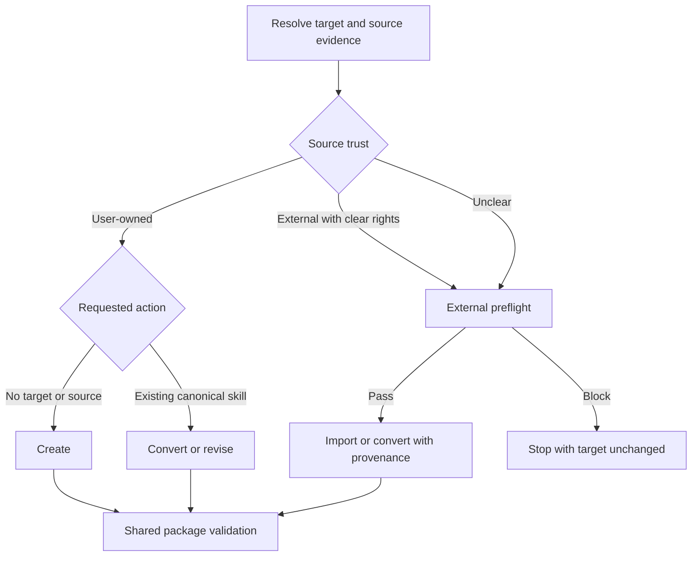

# Unified Skill Authoring Kata - Plan

## Goal Capsule

| Field | Value |
| --- | --- |
| Objective | A user can add or improve one skill through one safe Kata that preserves ownership, rights, resources, and stable personal preferences. |
| Means | Replace the two authoring entry points with `kata-write-skill`, which uses a small route kernel and branch references (KTD1-KTD6). |
| Authority | The user request controls intent. Repository instructions control package rules. License terms and safety gates can stop external-source work. |
| Execution profile | Modify the Kata plugin source only. Do not install, publish, or change remote state. |
| Stop conditions | Stop before a target change when ownership, reuse rights, the canonical source package, or a central risky capability remains unresolved. |
| Tail ownership | The implementer runs structural tests and route smoke cases. A later Dojo task can add repeated evaluation evidence. |

---

## Product Contract

### Summary

Add `kata-write-skill` as the single Kata for skill creation, external import, conversion, revision, and personalization.
The Kata must classify source trust before it selects the requested action.
It must keep external-source rights and safety checks intact while it gives user-owned skills a shorter path.
Every successful route must apply one shared work contract and declare a subject from one canonical vocabulary.

### Problem Frame

`kata-build-skill` and `kata-import-skill` split one user job across two packages.
Neither package owns conversion to a shared library contract, personalization as
a clear behavior, or canonical subject metadata.
This split makes source ownership, route selection, and later Dojo integration harder to explain and test as one lifecycle.

### Key Decisions

- **Use one authoring Kata.** (session-settled: user-directed — chosen over separate build and import packages: creation, import, conversion, and personalization are forms of one skill-library job.) Governs R1-R4, R11, R12.
- **Keep full Dojo evaluation as a later maturity step.** (session-settled: user-approved — chosen over a required first-version evaluation suite: structural tests and route smoke cases can prove the initial package.) Governs R10.
- **Use one canonical subject vocabulary.** (session-settled: user-directed — chosen over separate taxonomies in each skill: one quick lookup prevents identifier drift while frontmatter keeps classification with the package.) Governs R14-R16.

### Requirements

**Routing and conversion**

- R1. The plugin exposes `kata-write-skill` as one entry point for creating, importing, converting, revising, or personalizing a skill.
- R2. The Kata classifies the source as user-owned, external with clear rights, or unclear before it selects the requested action.
- R3. The create path starts from a real task or repeated failure when no source skill or local target exists.
- R4. The convert path brings an existing skill into the current library contract. It changes a preference only when that preference is stable and applies to one canonical source skill.
- R5. The Kata preserves supported metadata, resources, callers, safety rules, and unrelated behavior when it revises a local skill.

**Rights, trust, and provenance**

- R6. External content and content with unclear ownership complete license and safety preflight before any target change or source execution.
- R7. A blocked preflight leaves the target unchanged when rights are absent, unclear, or incompatible, or when a central risky capability remains unresolved.
- R8. An imported or externally derived skill keeps required license text and records its author, repository, source path, exact revision, license, and local changes in `README.md`.
- R9. History mining occurs only when the user asks for it, names its workspace and time range, and confirms each pattern before it becomes a rule.

**Package quality and authority**

- R10. The initial package passes structural checks and realistic route smoke cases without requiring a full Dojo evaluation suite.
- R11. The Kata stays host-neutral, treats discovery tools such as `npx skills` as optional, and does not install or publish a result without a request.
- R12. The migration validates the replacement before it removes `kata-build-skill` and `kata-import-skill`, and it does not add wrapper packages.
- R13. Every output skill defines its purpose, output, acceptance criteria, context, discretion, authority limits, escalation, required capability, verification, and completion conditions when they apply.
- R14. The Kata keeps the reusable skill, participant roles, and invocation-specific assignment separate. A skill describes possible boundaries; the current assignment grants actual authority.
- R15. `SUBJECTS.md` defines the canonical subject identifiers. A migrated Kata declares one identifier in `metadata.subject`; a temporary table covers only unmigrated packages.
- R16. The Kata keeps subject, practice, work profile, and execution profile separate. It does not infer work complexity from runtime, model name, tool, or agent count.

### Acceptance Examples

- AE1. Covers R1-R3, R10. Given a repeated local task with no source skill, when the user asks for a skill, the Kata creates a focused original package without external attribution.
- AE2. Covers R1, R2, R6-R8. Given a named MIT-licensed source skill, when the user asks to import it, the Kata reviews the complete source package before it copies content and retains the license and source record.
- AE3. Covers R6, R7. Given an external skill with no clear license, when the user asks to add it, the Kata stops before it changes the target.
- AE4. Covers R2, R4, R5. Given a user-owned local skill and a stable skill-specific preference, when the user asks to personalize it, the Kata edits the canonical package in place and preserves unrelated resources.
- AE5. Covers R2, R4-R8. Given a previously imported skill, when the user asks to personalize it, the Kata keeps its source identity, license, attribution, and safety floor.
- AE6. Covers R4, R9. Given a one-run preference or an unconfirmed pattern from chat history, when the user asks for help, the Kata keeps that preference out of the skill package.
- AE7. Covers R2, R6, R7. Given an existing skill with unclear ownership, when the user asks to personalize it, the Kata uses the import preflight and does not assume that a local directory proves ownership.
- AE8. Covers R13, R14. Given any successful route, the resulting skill defines observable completion and bounded authority while the assignment records the actual objective, authority, resources, and acceptance relationship.
- AE9. Covers R15, R16. Given a skill that uses code to perform accounting work, the Kata files it under accounting when accounting knowledge determines whether the result is correct.

### Scope Boundaries

#### Deferred to Follow-Up Work

- Add a full Dojo suite after real use supplies stable route cases and outcome checks.
- Consider a future Dojo dispatcher command after the skill-library lifecycle has more than one stable operation.

#### Outside This Change

- Add a new `$jido` command for skill-library mutation.
- Install the new skill globally, publish the plugin, or change remote state.
- Mine unrelated chat history or infer permanent preferences without user confirmation.
- Add compatibility wrappers for the retired package names.

---

## Planning Contract

### Key Technical Decisions

- KTD1. **Use a two-axis route.** Classify source trust first, then select create, import, or convert. This prevents conversion and personalization from bypassing external-source controls.
- KTD2. **Use a small route kernel with branch references.** Keep shared package construction and completion checks in `SKILL.md`. Put branch-only rules in `references/create.md`, `references/import.md`, and `references/convert.md`. Put the common work specification in `references/library-contract.md`.
- KTD3. **Make external preflight atomic.** Complete rights and safety review before target mutation or execution. Treat unclear ownership as external until evidence proves otherwise.
- KTD4. **Convert the canonical source only.** A one-run preference stays in the request. A repository-wide preference belongs in the active instruction file. A stable one-skill preference belongs in that skill.
- KTD5. **Use a staged direct cutover.** Add and validate `kata-write-skill` before a final dependent unit removes the old packages. Do not keep thin wrappers because normal leaf skills must remain self-contained.
- KTD6. **Split first-version proof from maturity evidence.** Use deterministic package tests and focused route smoke cases now. Reserve repeated Dojo evaluation for later evidence.
- KTD7. **Keep classification with the package.** `SUBJECTS.md` defines canonical subject identifiers. A migrated skill declares one in `metadata.subject` and leaves the legacy table. Practice and execution details do not create new subjects.

### High-Level Technical Design



The route kernel owns target and source classification.
Each branch reference owns only its branch procedure and stop conditions.
All successful branches return to the same package validation and report contract.

### Output Structure

```text
skills/kata-write-skill/
  SKILL.md
  agents/
    openai.yaml
  references/
    create.md
    import.md
    convert.md
    library-contract.md
    authoring-principles.md
    skill-template.md
SUBJECTS.md
```

### Sequencing

1. Add the shared route kernel and original-skill path without changing current documentation or removing existing packages.
2. Add the external-source preflight and import path.
3. Add the conversion and bounded-personalization path for owned and imported skills.
4. Run the full first-version checks, update active documentation, and remove both old packages in one final cutover.

### System-Wide Impact

- The change reduces two visible skill entries to one and changes the direct invocation name.
- The change adds `SUBJECTS.md` as the canonical subject vocabulary and a temporary table for unmigrated packages.
- A running host can keep the two old entries in its session cache until the user restarts it.
- Plugin manifests already load the complete `skills/` directory, so they need no path registry change.
- The workspace instruction file outside this repository can retain stale package names and needs a separate operator update.

### Risks and Mitigations

- **Trust-route bypass:** A local directory can contain imported content. KTD1 and KTD3 require ownership evidence before conversion.
- **Instruction growth:** Combining branches can make `SKILL.md` too large. KTD2 keeps conditional detail in branch references.
- **Compatibility break:** Direct invocations of the old names stop after cutover. KTD5 delays removal until the replacement passes all checks and active docs use the new name.
- **Weak behavioral proof:** Static validation cannot prove model behavior. KTD6 adds realistic route smoke cases and defers only repeated optimization evidence.
- **False personalization:** Incidental or temporary preferences can become permanent rules. KTD4 and R9 require stable scope and user confirmation.

### Sources and Research

- `skills/kata-build-skill/SKILL.md` owns the current original-skill outcome, package construction, and realistic verification rules.
- `skills/kata-import-skill/SKILL.md` owns the current rights, safety, provenance, and isolated execution controls.
- `AGENTS.md` defines Kata naming, package structure, attribution placement, host neutrality, and installation boundaries.
- `README_V2.md` places skill-library creation and evaluation in Dojo and requires reversible, tested package migration.
- `docs/plans/skill-import-queue.md` already groups build and import as one covered authoring area.
- `dojo/lib/kata_evolve/skill.ex` provides reusable frontmatter and expected-name validation for a focused structural test.
- `references/mattpocock-skills/skills/productivity/writing-for-agents/` supplies outcome-oriented completion, context pointers, progressive disclosure, and no-op pruning.
- `references/compound-engineering-plugin/.agents/skills/ce-skill-work/` and `docs/solutions/skill-design/portable-agent-skill-authoring.md` supply conditions over case lists, protocol and judgment separation, bounded authority, portable activation, and proportionate verification.

### Source Adaptation Decisions

| Decision | Source concept | Kata form |
| --- | --- | --- |
| Adopt | Outcome-first design | Require result, next consumer, one done condition, and only decision-bearing intent before workflow. |
| Adopt | Conditions instead of case lists | Require the deciding property; retain a list only when every item is required coverage. |
| Adopt | Protocol versus judgment | Keep falsifiable state, gates, scope, authority, evidence, and handoffs explicit; remove unsupported reasoning recipes. |
| Adopt | Progressive disclosure and context cost | Keep the outcome and protocol kernel inline; load substantial branch-only or late material through conditional pointers. |
| Adopt | Bounded authority | Define one compact envelope for consequential work and allow inherited authority to narrow only. |
| Adopt | Proportionate verification | Always test mechanical contracts and target behavior checks to routing, mutation, portability, and consumer risk. |
| Change | A completion criterion for every step | Use one skill-level done bar. Add local checks only at unsafe or fragile seams. |
| Change | Host invocation mechanics | Keep a portable activation contract. Leave command syntax and invocation flags to host adapters. |
| Change | Model-specific portability policy | Keep capability and evidence rules. Remove vendor and model preference names from the library contract. |
| Reject | Leading-word optimization as a required technique | It is optional writing judgment, not a library contract. |
| Reject | Mandatory subagent review | Independent review is a proportional check, not a required host capability for every edit. |

---

## Implementation Units

### U1. Add the route kernel and original-skill path

**Goal:** Create the new package with the shared contract and a complete path for original skill creation and revision.

**Requirements:** R1-R5, R10, R11.

**Dependencies:** None.

**Files:**

- Create `skills/kata-write-skill/SKILL.md`.
- Create `skills/kata-write-skill/references/create.md`.
- Create `skills/kata-write-skill/agents/openai.yaml`.
- Create `dojo/test/skills/add_skill_test.exs`.

**Approach:**

1. Define the observable package outcome, source-trust classification, route return contract, shared package rules, and common verification in the main file per KTD1 and KTD2.
2. Put original-skill framing, selection boundaries, resource choices, and realistic request checks in the create reference.
3. Add interface metadata with the `kata-write-skill` name and one short description of the unified job.
4. Add structural tests for frontmatter identity, interface metadata, reference existence, and package links.

**Patterns to follow:** Use the focused outcome and smallest-complete-package rules in `skills/kata-build-skill/SKILL.md`. Use the main-file and conditional-reference split in `skills/jido/`.

**Test scenarios:**

- A request for a new skill from a repeated local task selects create and produces an original package with an observable done condition.
- A request with an external source does not use create and stops at the unavailable import branch until U2 adds it.
- A request to change an existing local skill preserves supported metadata and referenced resources.
- Structural validation rejects a directory or frontmatter name that does not equal `kata-write-skill`.
- Structural validation reports a missing branch reference or missing interface field.

**Verification:** The package passes focused structural tests, and a temporary-workspace create request produces a valid package without external attribution.

### U2. Add external-source rights and safety controls

**Goal:** Add the import path without weakening the current license, provenance, or source-execution gates.

**Requirements:** R1, R2, R6-R8, R10-R12.

**Dependencies:** U1.

**Files:**

- Modify `skills/kata-write-skill/SKILL.md`.
- Create `skills/kata-write-skill/references/import.md`.
- Modify `dojo/test/skills/add_skill_test.exs`.

**Approach:**

1. Add the external and unclear-ownership routes to the main kernel per KTD1 and KTD3.
2. Move the current source qualification, rights, safety, copying, attribution, and isolated-test controls into the import reference.
3. Make candidate discovery capability-based. Mention `npx skills` only as an available option, not as a required dependency.
4. Require a complete preflight before target mutation or execution and a target-unchanged result for blocked work.

**Execution note:** Start with blocked-path tests because rights and central safety failures must have no partial target effect.

**Patterns to follow:** Preserve all load-bearing controls from `skills/kata-import-skill/SKILL.md`. Keep author credits in `README.md` and required notices in the package per `AGENTS.md`.

**Test scenarios:**

- An MIT-licensed source with a known revision passes preflight and retains license text and complete attribution.
- A source with no license stops before any target file changes.
- An incompatible license stops before copying.
- A source with an unresolved central secret, network, binary, hook, or destructive-file capability stops before execution.
- A source with unclear ownership enters import preflight instead of the user-owned route.
- An unavailable `npx skills` command does not block work when the source is already known or another safe discovery capability exists.

**Verification:** Focused tests pass, and temporary-workspace import cases prove both a successful permissive-license import and a no-change blocked result.

### U3. Add bounded conversion and personalization

**Goal:** Convert user-owned and imported skills to the shared library contract without changing unrelated behavior or source identity.

**Requirements:** R1, R2, R4-R9, R11.

**Dependencies:** U2.

**Files:**

- Modify `skills/kata-write-skill/SKILL.md`.
- Create `skills/kata-write-skill/references/convert.md`.
- Create `skills/kata-write-skill/references/library-contract.md`.
- Create `skills/kata-write-skill/references/authoring-principles.md`.
- Create `skills/kata-write-skill/references/skill-template.md`.
- Create `SUBJECTS.md`.
- Modify `dojo/test/skills/add_skill_test.exs`.

**Approach:**

1. Add the canonical-target, library-contract, and stable-preference gates per KTD4.
2. Route imported or mixed-source conversion through the external preflight and preserve each source record.
3. Keep one-run preferences in the active request and repository-wide preferences in the active instruction file.
4. Make history mining opt-in, bounded to the named workspace and time range, and subject to user confirmation before edits.
5. Add `metadata.subject` to `kata-write-skill` and the exercised `kata-status-report` conversion. Remove only those two rows from the legacy table.

**Patterns to follow:** Preserve resource callers and supported metadata as required by `skills/kata-build-skill/SKILL.md`. Preserve imported-source rights and identity as required by `skills/kata-import-skill/SKILL.md`.

**Test scenarios:**

- A stable skill-specific preference updates a user-owned canonical package and preserves unrelated metadata and resources.
- A one-run preference does not change the skill.
- A repository-wide preference routes to the active instruction file instead of the skill.
- A converted or personalized imported skill keeps its license, source identity, attribution, and safety rules.
- A mixed-source change records the external contribution before it changes the local skill.
- A request to mine history reads only the user-named workspace and time range and waits for confirmation before it writes a rule.

**Verification:** Focused tests pass, the subject index contains each current Kata once, and temporary-workspace conversion cases prove the user-owned, imported, one-run, and unclear-ownership boundaries.

### U4. Cut over active documentation and retire the old packages

**Goal:** Make `kata-write-skill` the only active authoring entry point after the new package passes all first-version checks.

**Requirements:** R1, R10-R12.

**Dependencies:** U1-U3.

**Files:**

- Modify `README.md`.
- Modify `README_V2.md`.
- Modify `docs/plans/skill-import-queue.md`.
- Modify `dojo/test/skills/add_skill_test.exs`.
- Remove `skills/kata-build-skill/SKILL.md`.
- Remove `skills/kata-build-skill/agents/openai.yaml`.
- Remove `skills/kata-import-skill/SKILL.md`.
- Remove `skills/kata-import-skill/agents/openai.yaml`.

**Approach:**

1. Run all structural and route smoke checks before package removal per KTD5.
2. Replace active descriptions of the two packages with the unified job and its three paths.
3. Update the V2 Dojo mapping and import queue without changing historical attribution or source records.
4. Remove both old package directories in the same cutover and do not add wrappers or aliases.
5. Extend the structural test to reject active documentation references and remaining old package directories.

**Execution note:** Treat this unit as a smoke-first cutover. Do not remove the old packages until U1-U3 pass together.

**Patterns to follow:** Follow the reversible migration rules in `README_V2.md` and the root skill-table format in `README.md`.

**Test scenarios:**

- Active documentation lists `kata-write-skill` once and does not list either retired package as an available skill.
- Both old directories are absent after cutover.
- The new package and all references remain valid after removal.
- No wrapper, alias, install action, publication action, global-skill edit, or remote write occurs.
- A fresh host session discovers `kata-write-skill`; the report states that an existing session can need a restart to drop cached old entries.

**Verification:** The complete focused test passes, active documentation has no stale entry, the old directories are absent, and a clean-session discovery check shows only the unified package.

---

## Verification Contract

| Check | Command or method | Expected result |
| --- | --- | --- |
| Structural skill test | `cd dojo && mix test test/skills/add_skill_test.exs` | Frontmatter, interface metadata, references, documentation, and retired-path assertions pass. |
| Patch hygiene | `git diff --check` | No whitespace or patch-format errors. |
| Active-name audit | `rg -n 'kata-build-skill|kata-import-skill' README.md README_V2.md docs/plans/skill-import-queue.md skills` | No active reference or package path remains. |
| Create smoke case | Run AE1 in an isolated temporary repository. | A valid original skill package is created without external attribution. |
| Import smoke cases | Run AE2 and AE3 in isolated temporary repositories. | The permissive source retains provenance, and the unclear-license source leaves the target unchanged. |
| Conversion smoke cases | Run AE4-AE7 in isolated temporary repositories. | Stable owned changes land; imported provenance remains; temporary and unclear-ownership cases do not bypass their gates. |
| Subject audit | Compare `metadata.subject` values and the temporary legacy table with the canonical vocabulary. | Each current Kata appears in exactly one location under a valid subject. |
| Change review | Inspect `git status --short` and the final diff. | Only planned package, test, and documentation changes exist. |

---

## Definition of Done

- `skills/kata-write-skill/` contains one valid route kernel, three route references, one formal contract, one authoring-principles reference, one copy-ready template, and matching interface metadata.
- Source trust is classified before action selection, and all external or unclear sources complete atomic preflight.
- Conversion changes only a canonical package and preserves required metadata, resources, rights, provenance, and safety rules.
- `SUBJECTS.md` defines the canonical subjects. `kata-write-skill` and `kata-status-report` declare subjects in frontmatter; unmigrated packages remain only in the legacy table.
- Output skills separate reusable work, participant roles, assignment authority, work profile, and execution profile.
- Structural tests and all first-version route smoke cases pass.
- `README.md`, `README_V2.md`, and `docs/plans/skill-import-queue.md` describe the unified skill.
- The two old package directories and active documentation entries are absent, with no wrapper packages.
- The implementation does not install, publish, change global skills, or write remote state.
- The final diff contains no abandoned experiments, duplicate rules, unrelated edits, or stale package references.
