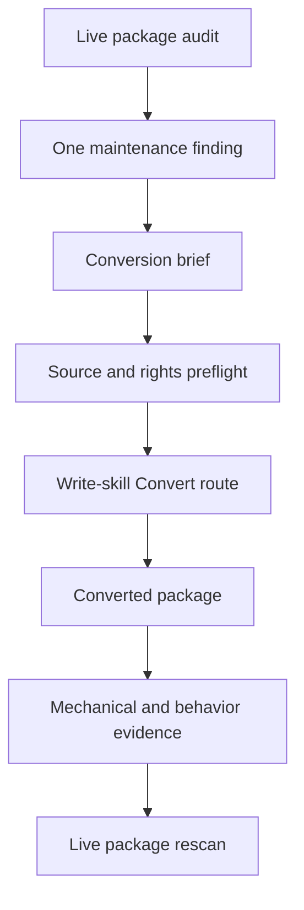
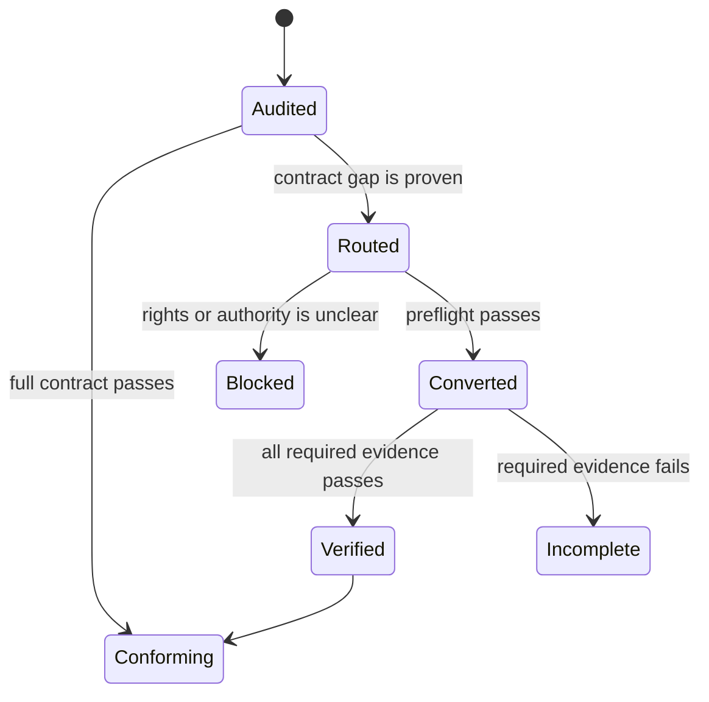
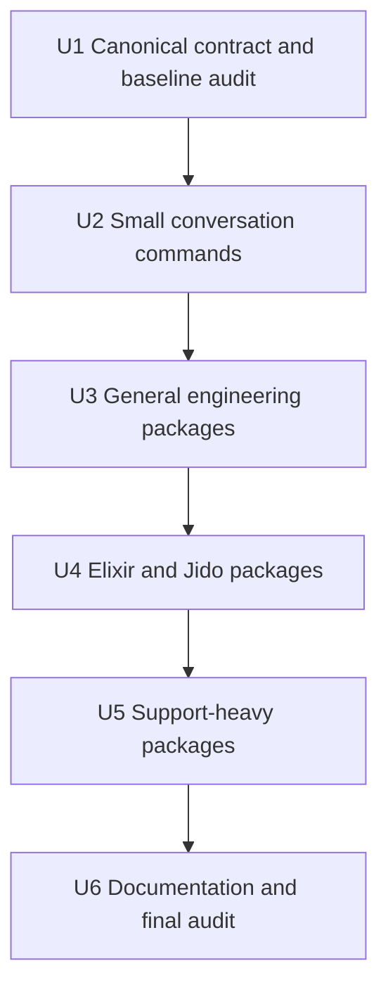

# Complete Skill Template Conversion - Plan

## Goal Capsule

- **Objective:** An operator can select, run, verify, and hand off every active Kata skill through one consistent work contract.
- **Means:** Audit all 36 active packages, then route every proven nonconforming package through `kata-maintain-skill` and `kata-write-skill` in risk order. (KTD2, KTD4)
- **Authority:** Local reads and local repository writes only. The work does not authorize commits, remote changes, installation, release, publication, package deletion, or package rename.
- **Execution profile:** Deep repository refactor with one package as the maintenance unit.
- **Stop conditions:** Stop a package before its first edit when source rights are unclear. Stop when a behavior change needs an owner decision, when a required check cannot produce reliable evidence, or when the work would overlap unrelated dirty files.
- **Tail ownership:** `kata-maintain-skill` owns the finding and conversion brief. `kata-write-skill` owns the package conversion and verification. A later explicit request can route a verified change to `kata-commit`.

---

## Product Contract

### Summary

Finish the active-library migration to the current `kata.skill/v1` contract.
Audit every direct package under `skills/`.
Use the canonical maintenance and writing skills for each package that does not conform.

### Problem Frame

The repository has one current skill template, but only 14 of 36 active packages declare all eight required facets.
Four packages have partial metadata and 18 packages have no `kata.skill/v1` metadata.
Complete metadata is also not proof of a complete activation, authority, completion, verification, or handoff contract.
This mixed state causes inconsistent routing, authority, provenance, and workflow edges.

### Key Decisions

- **Replace the old migration plan with a full active-library conversion.** (session-settled: user-directed — chosen over continuing the old authoring plan: the remaining problem is package conversion, not authoring-workflow design.) Governs R1, R2, R3, R4.
- **Keep skill frontmatter as the canonical classification source.** (session-settled: user-directed — chosen over a separate subject index: a second manual index can drift from the package.) Governs R8, R13.

### Requirements

#### Scope and routing

- R1. The audit covers each direct `skills/*/SKILL.md` package that exists when execution starts.
- R2. The audit checks the full library contract and does not treat facet presence as proof of conformance.
- R3. Each proven nonconforming package gets one `kata-maintain-skill` finding with one `Route` disposition and one complete conversion brief.
- R4. Each routed package goes through the `kata-write-skill` Convert route and ends with a verified result or an explicit blocker.

#### Contract and preservation

- R5. Each converted package states its outcome, next consumer, done condition, activation boundary, work protocol, authority envelope, assignment inputs, information placement, verification, and failure direction.
- R6. Each converted package declares all eight `kata.skill/v1` facets with meanings that agree with the canonical library contract.
- R7. Each conversion preserves supported behavior, callers, references, scripts, templates, adapters, notices, licenses, attribution, and unrelated content.
- R8. Subject and workflow facets stay in skill frontmatter. No `SUBJECTS.md` or other manual classification index is added.
- R9. An external or unclear source passes the source, revision, author, license, notice, and safety preflight before any target edit.

#### Verification and completion

- R10. Each changed package passes mechanical checks and behavior checks that are proportionate to its activation, authority, side effects, and next consumer.
- R11. A committable local repository result can hand off to `kata-commit` without losing its specialized result type.
- R12. Repository documentation states the live migration state and does not keep stale optimization or provenance claims after package text changes.
- R13. The final audit reports zero active legacy packages, zero invalid packages, zero broken package links, and zero missing required notices.
- R14. The conversion does not change reference repositories, archived skills, Dojo files, `skills/index.html`, installed skills, remote state, or unrelated worktree changes.

### Actors

- A1. The operator is the accountable owner and accepts behavior or authority changes that repository evidence cannot settle.
- A2. `kata-maintain-skill` is the library maintainer and produces one evidence-backed finding and conversion brief.
- A3. `kata-write-skill` is the package writer and converts one routed package inside the granted authority.
- A4. The verifier checks package evidence and the final library state. One agent can hold A2, A3, and A4, but it must keep their responsibilities separate.

### Key Flows

- F1. Package conversion
  - **Trigger:** The live audit proves that one active package does not conform.
  - **Actors:** A1, A2, A3, A4.
  - **Steps:** A2 records one finding and one `Route` disposition. A3 completes source preflight, converts the full package, and returns verification evidence. A4 re-runs the package audit.
  - **Outcome:** The package conforms or has one explicit blocker.
  - **Covered by:** R2, R3, R4, R7, R9, R10.
- F2. Safe resume
  - **Trigger:** Execution restarts after an interruption or a separate package change.
  - **Actors:** A2, A4.
  - **Steps:** Rebuild the live inventory. Re-audit the next package with the full rubric. Do not use the plan file as a progress register.
  - **Outcome:** A conforming package is not rewritten, and a nonconforming package enters F1.
  - **Covered by:** R1, R2, R13, R14.
- F3. Library completion
  - **Trigger:** All package cohorts have completed F1 or have no finding.
  - **Actors:** A1, A2, A4.
  - **Steps:** Re-audit the canonical pair. Run the whole-library checks. Update migration and provenance claims from live evidence.
  - **Outcome:** The active library satisfies R13, or the result names the package that prevents completion.
  - **Covered by:** R11, R12, R13, R14.

### Acceptance Examples

- AE1. A package has all eight facets but has an incomplete authority envelope. The audit marks it nonconforming and routes one package-level finding. Covers R2, R3, R5.
- AE2. A package has no metadata. The maintainer records one conversion finding for the package, not eight independent metadata findings. Covers R3, R6.
- AE3. A source license does not cover one required support file. The writer stops before the first target edit and reports the missing right. Covers R4, R7, R9.
- AE4. A conversion changes a description. Verification checks positive activation, an adjacent negative case, and deliberate direct use. Covers R5, R10.
- AE5. A conversion changes a script. Verification runs representative input in an isolated workspace and checks the observable result. Covers R7, R10.
- AE6. Execution restarts after ten packages. The live audit passes those packages without rewriting them and continues with the next proven gap. Covers R1, R2, R13, R14.

### Scope Boundaries

#### In scope

- All active direct packages under `skills/`.
- The canonical contract in `skills/kata-write-skill/` and the routing contract in `skills/kata-maintain-skill/` when a proven ambiguity blocks consistent conversion.
- Root documentation and the documentation index when they describe migration state, provenance, optimization evidence, or the current plan.

#### Outside this plan

- Reference repositories, archived skills, and external source updates.
- Dojo catalog code, Dojo tests, model evaluation, tuning, and optimization runs.
- Installation tests, host publication, distribution work, releases, and remote repository changes.
- Package deletion, rename, consolidation, or a new skill unless a later operator decision grants that scope.
- Commits. A commit remains a separate explicit action.

### Dependencies and Sources

- `skills/kata-write-skill/SKILL.md` owns the Create, Import, and Convert workflow.
- `skills/kata-write-skill/references/library-contract.md` owns the formal package contract.
- `skills/kata-write-skill/references/authoring-principles.md` owns the outcome-first and context-cost rules.
- `skills/kata-write-skill/references/convert.md` owns conversion preservation and verification.
- `skills/kata-write-skill/references/import.md` owns external-source preflight.
- `skills/kata-maintain-skill/SKILL.md` owns one-finding library maintenance and the `Route` handoff.
- `README.md` owns the active skill list and attribution.
- `docs/plans/skill-import-queue.md` supplies existing import and provenance constraints.

---

## Planning Contract

### Key Technical Decisions

- KTD1. **Settle facet and authority semantics before bulk conversion.** `consumes` names accepted input types, while the work contract states whether they are alternatives or required together. `produces` names stable result types, while the work contract states route conditions. `profile` is the normal profile, and conditional profiles stay in the work contract. `authority` records the highest normal durable effect on an in-scope target. Git ref updates are local writes. Temporary isolated writes stay in the inline authority envelope. Catalog matches remain workflow candidates, not proof that a handoff can run.
- KTD2. **Use one package as one maintenance unit.** A cohort controls sequence only. One finding can include coupled contract gaps in one package, but it cannot include an unrelated overlap, retirement, or redesign issue.
- KTD3. **Use one committable output rule.** A local repository mutation that is ready for commit produces `verified-change` and can also produce a specialized result. Read-only and terminal results do not add `verified-change`.
- KTD4. **Convert from low risk to high context cost.** Small conversation commands test the contract first. Script-bearing, adapter-bearing, and large reference packages run after the canonical rules are stable.
- KTD5. **Preserve the full package and source identity.** A conversion reads every support file and caller before an edit. External-source packages run rights and safety preflight first.
- KTD6. **Use live state for resume.** Re-run the full rubric against the current package. Do not add a migration status field, tracking table, or second classification index.
- KTD7. **Use focused behavior checks without Dojo.** Each conversion runs direct scenarios that test changed activation, authority, restraint, output shape, scripts, and consumer handoff. Dojo remains a later evaluation surface.

### High-Level Technical Design

The diagrams show planning boundaries and sequence. They do not prescribe implementation text.

#### Contract data flow

#### Package state lifecycle

#### Cohort dependencies

### Implementation Constraints

- Read the complete target package and its callers before each conversion.
- Run source preflight before an edit for each imported or unclear package.
- Preserve each `agents/openai.yaml`, reference, script, template, asset, license, and attribution entry unless the package contract proves a required change.
- Keep each package focused. Do not add template headings with no content.
- Prune copied or host-specific instructions only when the conversion preserves the supported outcome and safety floor.
- Record the exact reason when a required behavior check does not run.
- Record a baseline hash for each dirty or untracked excluded file before execution. Compare those hashes after each cohort and at final completion.
- Treat the untracked `skills/index.html` and all current Dojo changes as unrelated work.

### Risks and Mitigations

| Risk | Consequence | Mitigation |
| --- | --- | --- |
| Facet meanings drift across packages | The workflow graph suggests invalid handoffs | Finish U1 before later cohorts and re-audit the canonical pair in U6 |
| A template-only edit removes useful behavior | The skill passes metadata checks but becomes less useful | Characterize the current outcome, trigger, resources, and safety rules before editing |
| External-source rights are assumed | Required notices or reuse rights can be lost | Run KTD5 preflight before the first edit and stop on missing evidence |
| Large packages exceed useful context | References or callers can be skipped | Convert support-heavy packages last and verify every referenced resource |
| A text change leaves stale optimization evidence | README or metadata claims no longer match the skill | Remove or rebind the claim to current evidence without running Dojo |
| Concurrent dirty work is overwritten | User work is lost or mixed into the conversion | Hash excluded files, inspect the diff after each cohort, and stop on overlap |

### Assumptions

- The active set is the 36 direct `skills/*/SKILL.md` packages in the live repository at planning time.
- The current 14 full-facet packages still need a full contract audit, but they need edits only when the audit proves a gap.
- The current 22 partial or legacy packages need conversion unless live evidence changes before execution.
- No source-rights decision, deletion, rename, commit, or remote action is implied by this plan.

---

## Implementation Units

### U1. Stabilize the canonical contract and audit the converted baseline

- **Goal:** Make the canonical conversion rules consistent, then re-audit the 14 full-facet packages.
- **Requirements:** R1, R2, R3, R4, R5, R6, R8, R10, R11, R14.
- **Dependencies:** None.
- **Files:** `skills/kata-write-skill/`, `skills/kata-maintain-skill/`, and the 12 other full-facet packages in Appendix A.
- **Approach:** Record the live package and dirty-file baseline. Audit `kata-write-skill` first. If KTD1 or KTD3 needs a canonical text change, route one finding through the same maintain-to-write loop. Audit `kata-maintain-skill` next. Then audit the other 12 full-facet packages. Convert only packages with a proven full-contract gap.
- **Execution note:** Characterize current activation, authority, output types, and consumer handoffs before each edit.
- **Test scenarios:** A full-facet package has an incomplete authority envelope and must route. A specialized committable result has no `verified-change` edge and must route. A read-only package writes only to a temporary isolated workspace and keeps the temporary-write rule inline. A fully conforming package gets no invented finding and no edit.
- **Verification:** Re-run the full package rubric after each finding. Confirm that KTD1 and KTD3 have one canonical owner. Confirm that no excluded file hash changes.

### U2. Convert the small conversation commands

- **Goal:** Convert six explicit-use conversation packages with the smallest complete contracts.
- **Requirements:** R2, R3, R4, R5, R6, R7, R9, R10, R14.
- **Dependencies:** U1.
- **Files:** `skills/bro/`, `skills/in-your-own-words/`, `skills/ketchup/`, `skills/ketchup-video/`, `skills/sharpen/`, `skills/unslop/`.
- **Approach:** Process one package at a time through the maintain-to-write loop. Keep explicit activation and short output contracts. Preserve each license and any media or output constraint.
- **Test scenarios:** A direct invocation selects the package and returns its stated output shape. An adjacent request does not select the package. A missing chat or media prerequisite returns a question or blocker instead of invented content.
- **Verification:** Check frontmatter, name, outcome, done condition, explicit-use trigger, adjacent non-trigger, authority, license, and representative output for each package.

### U3. Convert the general engineering packages

- **Goal:** Convert six general packages that have broader judgment or support resources.
- **Requirements:** R2, R3, R4, R5, R6, R7, R9, R10, R11, R14.
- **Dependencies:** U2.
- **Files:** `skills/kata-blast-radius/`, `skills/kata-create-verification-skill/`, `skills/kata-recall/`, `skills/kata-show-your-work/`, `skills/kata-showme/`, `skills/kata-technical-writing/`.
- **Approach:** Preserve each package's distinct job. Keep activation boundaries between investigation, implementation, documentation, visualization, and decision logging. Verify templates, adapters, assets, and source notices with the package that owns them.
- **Test scenarios:** A read-only investigation does not mutate the target. A local-write package stops before an external action. A resource pointer loads only for its branch. A generated artifact can be used by its next consumer without clarification.
- **Verification:** Run representative positive and adjacent-negative requests. Resolve every resource link. Check the decision-log template and host adapter when their owning package changes.

### U4. Convert the Elixir and Jido packages

- **Goal:** Convert the three Elixir packages and four Jido packages without changing their current technical behavior.
- **Requirements:** R2, R3, R4, R5, R6, R7, R9, R10, R11, R14.
- **Dependencies:** U3.
- **Files:** `skills/kata-ex-coverage/`, `skills/kata-ex-design-review/`, `skills/kata-ex-hunt-dead-code/`, `skills/kata-jido-action/`, `skills/kata-jido-agent/`, `skills/kata-jido-ai/`, `skills/kata-jido-testing/`.
- **Approach:** Complete the partial facet blocks before the legacy Jido packages. Preserve current Elixir and Jido API guidance, package lenses, scripts, roots files, adapters, Apache notices, and README attribution. Move branch-only detail out of `SKILL.md` only when an existing or new package reference has one clear owner.
- **Execution note:** Use characterization checks for the current API and script behavior before contract edits.
- **Test scenarios:** Coverage analysis works from generated coverage input. Dead-code analysis runs representative source and roots input. A Jido action, agent, AI, or test request selects the matching package and keeps adjacent Jido work out. A missing dependency or API fact returns a blocker instead of stale guidance.
- **Verification:** Run changed scripts with representative isolated input. Check every reference and adapter. Compare Jido examples with the current package contract without running Dojo evaluation.

### U5. Convert the support-heavy packages

- **Goal:** Convert the three packages with the highest reference count or repository reach after the smaller cohorts prove the contract.
- **Requirements:** R2, R3, R4, R5, R6, R7, R9, R10, R11, R14.
- **Dependencies:** U4.
- **Files:** `skills/kata-principled/`, `skills/kata-setup/`, `skills/kata-plan/`.
- **Approach:** Convert `kata-principled` and verify all 24 command references. Convert `kata-setup` and preserve its template and current evaluation-evidence boundary. Convert `kata-plan` last, inspect all references and scripts, and reconcile internal statements that conflict with the current narrow `kata-work` contract.
- **Test scenarios:** Each named principle resolves to one existing reference. Setup preserves existing documents and does not claim unverified content. Plan routes code and knowledge work according to the current Kata boundaries. An unavailable planning dependency returns the documented fallback or blocker.
- **Verification:** Resolve every package-relative link. Run changed scripts with safe representative input. Check positive activation, adjacent routing, authority, output readiness, and next-consumer handoff for each package.

### U6. Re-audit the library and correct current documentation

- **Goal:** Prove complete active-library conformance and make repository claims match the verified result.
- **Requirements:** R1, R2, R7, R8, R10, R11, R12, R13, R14.
- **Dependencies:** U5.
- **Files:** `skills/*/SKILL.md`, package support files, `README.md`, `docs/README.md`.
- **Approach:** Re-audit `kata-maintain-skill` and `kata-write-skill`. Audit every package from the U1 execution baseline, which has 36 packages at plan time. Update migration, attribution, and optimization claims only from current evidence. Keep frontmatter as the canonical classification source. Do not add or update a generated index as part of this unit.
- **Test scenarios:** The audit finds a metadata-complete package with a weak contract. A stale optimization digest does not survive a text change. A broken link or missing notice prevents completion. A rerun reports every package as conforming and makes no package edit.
- **Verification:** Run the whole-library metadata, name, link, resource, adapter, license, attribution, and workflow-edge checks. Compare excluded-file hashes with the baseline. Review the final diff and confirm that it contains no Dojo, reference, archive, install, release, remote, or unrelated changes.

---

## Verification Contract

| Gate | Applies to | Evidence | Done signal |
| --- | --- | --- | --- |
| Working-tree boundary | Every unit | `git status --short` before and after each cohort, plus baseline hash comparison for excluded dirty files | No unrelated file changes |
| Metadata and names | Every package | Parse YAML frontmatter; compare `name` with its directory; require `schema`, `subject`, `practice`, `object`, `profile`, `authority`, `consumes`, and `produces` | Zero missing, invalid, or mismatched fields |
| Full contract rubric | Every package | Check outcome, consumer, done, activation, non-trigger when needed, protocol, judgment, authority, assignment, information, verification, and blocker behavior | Every field is explicit or safely combined |
| Package resources | Every changed package | Resolve all relative links; inspect references, scripts, templates, assets, adapters, notices, and callers | Zero broken links or missing required files |
| Source rights | Every imported or unclear package | Record source path, revision, author, license, notices, safety review, and README attribution | Preflight passes before the first edit |
| Behavior | Every changed contract | Run representative positive, adjacent-negative, authority-restraint, completion, and consumer-handoff scenarios that match the changed risk | Each required scenario has a result or an explicit skip reason |
| Executable support | Every changed script | Run representative isolated input and inspect the observable result | Script exits as expected and preserves its boundary |
| Repository hygiene | Every cohort and final | Run `git diff --check` and inspect the scoped diff | No whitespace errors, abandoned attempts, or out-of-scope edits |
| Final active-library audit | U6 | Audit all direct `skills/*/SKILL.md` packages from live state | The active count matches the execution baseline, and all packages conform |

Do not run Dojo checks or model evaluation for this plan.
Do not treat a passing facet scan as behavior proof.

---

## Definition of Done

- All active packages have a full-contract audit result in the execution report. The planning baseline has 36 packages.
- Every proven nonconforming package has one maintenance finding, one `Route` brief, one Convert result, and required verification evidence.
- All 22 packages that are partial or legacy at plan time conform, unless live evidence proves that the package no longer exists by an authorized change.
- The 14 full-facet packages pass the same rubric, and each proven gap is resolved through the same loop.
- Every active package declares all eight `kata.skill/v1` facets.
- Every active package has a usable outcome, activation, authority, assignment, completion, verification, and failure contract.
- Every committable local-write result can hand off as `verified-change` while it keeps any specialized result.
- All package links, resources, scripts, adapters, required licenses, notices, and README attribution pass.
- README migration and optimization claims match the live package text and evidence.
- The deleted old plan stays absent, and `docs/README.md` links to this plan.
- No `SUBJECTS.md`, migration status index, generated catalog dependency, or progress field is added.
- No Dojo file, reference repository, archive, installed skill, remote state, or unrelated dirty file changes because of this plan.
- No abandoned conversion attempt remains in the diff.
- A blocked or failed package prevents a claim that the library conversion is complete.

---

## Appendix

### A. Planning-time package inventory

#### Full facets, full-contract audit still required (14)

`jido`, `kata-benchmark-checklist`, `kata-commit`, `kata-correct`, `kata-interrogate`, `kata-maintain-skill`, `kata-neckbeard`, `kata-no-comments`, `kata-review-pr`, `kata-status-report`, `kata-sync-docs`, `kata-tdd`, `kata-work`, `kata-write-skill`.

#### Partial facets, conversion required (4)

`kata-ex-coverage`, `kata-ex-design-review`, `kata-ex-hunt-dead-code`, `kata-setup`.

#### No `kata.skill/v1` facets, conversion required (18)

`bro`, `in-your-own-words`, `kata-blast-radius`, `kata-create-verification-skill`, `kata-jido-action`, `kata-jido-agent`, `kata-jido-ai`, `kata-jido-testing`, `kata-plan`, `kata-principled`, `kata-recall`, `kata-show-your-work`, `kata-showme`, `kata-technical-writing`, `ketchup`, `ketchup-video`, `sharpen`, `unslop`.
